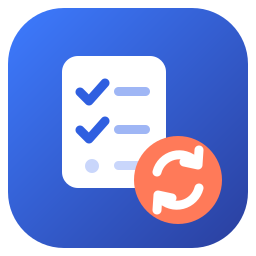

<p align="center">
  
</p>

# MyAnimeList – Jellyfin Plugin

Two things in one plugin for [Jellyfin](https://jellyfin.org/):

- **Metadata:** adds [MyAnimeList](https://myanimelist.net) as a metadata provider for anime series, seasons, episodes, movies and people, using the [Jikan](https://jikan.moe) API (through [Tenrai](https://tenrai.org) by default).
- **Sync:** updates your anime list as you watch: episode progress, completed shows, rewatches. Works with MyAnimeList, plus AniList, Kitsu, Annict, Shikimori and Simkl.

Built for **Jellyfin 12**.

## Installation

Add the plugin repository in Jellyfin under **Dashboard → Plugins → Repositories → +** :

```
https://github.com/StuxieDev/MyAnimeListPlugin/releases/latest/download/manifest.json
```

Then install **MyAnimeList** from the plugin catalogue and restart Jellyfin.

**Moving from ryandash's MyAnimeList and MyAnimeList-Sync (or vosmiic's Ani-Sync) plugins:** uninstall them first, then install this one and restart. Don't run them side by side: they register the same metadata provider and the same `/AniSync` API routes. Your metadata settings carry over, because this plugin uses the same settings file. Sync settings don't, so link your accounts again under the **Sync** tab. This plugin has its own plugin ID, so the other repositories can't "update" over it.

### Requirements

- Jellyfin 12.0 or newer
- For sync: an account on at least one of the list sites above, and an API app/client ID from it (MyAnimeList: [myanimelist.net/apiconfig](https://myanimelist.net/apiconfig))

## Metadata

Enable **MyAnimeList** as a metadata (and image) provider in your anime library's settings, then refresh the library's metadata.

For the best matches, name folders after the anime's MyAnimeList title, and use `Season 01` (or the first season's name with the season number):

```
Anime
└── Anime Name A
    ├── Specials
    │   └── Anime Name - S00E0# - Special Title.mkv
    ├── Season 01
    │   ├── Anime Name A - S01E01-E02.mkv
    │   └── Anime Name A - S01E03.mkv
    └── Season 02
        ├── Anime Name A - S02E01.mkv
        ├── Anime Name A - S02E02 Part 1.mkv
        └── Anime Name A - S02E02 Part 2.mkv
```

If a special has several episodes, number them S00E01, S00E02… so the right one is picked.

To skip the search, put the MyAnimeList ID in the series folder name as `[mal-<id>]`:

```
Anime
└── Attack on Titan [mal-16498]
    └── Season 01
        └── Attack on Titan - S01E01.mkv
```

Settings are under **Dashboard → Plugins → MyAnimeList → Metadata**: title language, which fields to fill in, people and genre limits, NSFW results, cache times and the Jikan URLs.

## Sync

1. Open **Dashboard → Plugins → MyAnimeList → Sync**.
2. Create an API app on the list site, using the callback URL the page shows, and enter its client ID (and secret).
3. Pick the Jellyfin user, select the site and authorize it.
4. Choose the libraries to watch and how rewatches and "plan to watch" are handled, then save.

Progress is sent when an episode or movie finishes playing, or (if you turn it on) when you mark it as played. Matching uses the item's MyAnimeList ID from the metadata above, or its AniList/AniDB IDs. **Manual Sync** brings a whole list into Jellyfin or the other way round.

With **Enable user pages** on and the Plugin Pages plugin installed, each user gets a **MyAnimeList Sync** page to link their own accounts.

## Build from source

```bash
dotnet build Jellyfin.Plugin.MyAnimeList/Jellyfin.Plugin.MyAnimeList.csproj -c Release
```

See [CONTRIBUTING.md](CONTRIBUTING.md) for development, testing and release details.

## Credits

Based on [jellyfin-plugin-myanimelist](https://github.com/ryandash/jellyfin-plugin-myanimelist) and [jellyfin-myanimelist-sync](https://github.com/ryandash/jellyfin-myanimelist-sync) by ryandash; the sync part is in turn a fork of [jellyfin-ani-sync](https://github.com/vosmiic/jellyfin-ani-sync) by vosmiic. Maintained by [StuxieDev](https://github.com/StuxieDev) as one standalone plugin, for Jellyfin 12. Metadata comes from [Jikan](https://jikan.moe) and [Tenrai](https://tenrai.org); not affiliated with MyAnimeList or the other list sites.

© Leo Ridgwell (StuxieDev) for changes made since the originals. Licensed under the [GNU General Public License v3.0](LICENSE.md), like jellyfin-ani-sync; the metadata code was published under the GNU GPL v2.
